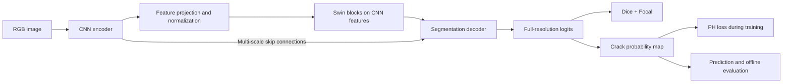

# Kiến trúc framework nghiên cứu Structural Defect Detection

Trạng thái: thiết kế trước triển khai. Tài liệu này chưa cung cấp package, CLI hoặc cấu hình chạy được. Các tên class, lệnh và trường YAML dưới đây là hợp đồng dự kiến.

Nguồn phạm vi: `PROJECT_SPECIFICATION_DEFINITION_DEEP_LEARNING_TDA_TEAM_2.docx` và các quyết định của người dùng trong phiên trao đổi kiến trúc.

## 1. Quyết định đã chốt

| Nội dung | Quyết định |
|---|---|
| Sản phẩm phiên bản đầu | Framework nghiên cứu; chưa làm giao diện web |
| Tổ chức | Python package theo src layout, OOP, ưu tiên composition |
| Nền tảng đề xuất | Python + PyTorch; phiên bản dependency khóa khi triển khai |
| Tác vụ đầu tiên | Binary semantic segmentation: crack và background; có ignore pixels |
| Mở rộng | Semantic segmentation nhiều lớp, mỗi pixel thuộc tối đa một lớp |
| Baseline chính | Hybrid CNN–Swin Transformer + persistent-homology loss |
| Hybrid | Nối tiếp CNN → projection → Swin blocks → decoder; skip connections nhiều mức từ CNN đến decoder |
| Đối chứng bắt buộc | Cùng Hybrid tắt PH để đo tác động của PH |
| Hướng tiếp theo | Tối ưu CNN encoder và compute toàn model; CNN-only là đối chứng bổ sung |
| Dữ liệu | Có thể phối hợp nhiều dataset phù hợp semantic segmentation |
| PH | Training-only; ban đầu áp dụng cho crack, ưu tiên H0; H1 mặc định tắt |
| Giao tiếp | CLI + YAML; sweep cũng khai báo bằng YAML |
| Tài nguyên | Nhiều máy, GPU 8/12/24 GB; thiết bị edge chưa chốt |

Baseline chính là cấu hình tham chiếu của dự án, không hàm ý đây là kiến trúc mới hoặc đã tốt hơn các phương pháp công bố.

## 2. Phạm vi phiên bản đầu

Một luồng hoàn chỉnh: kiểm tra dữ liệu → chuẩn hóa manifest → khóa split → training Hybrid + PH → validation → chọn checkpoint → đánh giá test → xuất dự đoán và báo cáo. Có sweep, resume và đối chứng tắt PH.

Chưa đưa vào phiên bản đầu: điều khiển drone, live video streaming, giao diện web, distributed training nhiều máy cho một run, scheduler tập trung, hoặc cam kết inference thời gian thực trên edge. Các interface cho inference/profiling được tách để bổ sung sau.

## 3. Ranh giới module và hợp đồng OOP

Package dự kiến: `src/structural_defect_detection/`; tên CLI dự kiến: `sdd`.

| Module | Thành phần chính | Trách nhiệm và giới hạn |
|---|---|---|
| `config` | Các config dataclass, `ConfigLoader` | Đọc YAML, resolve override, validate, tạo cấu hình bất biến cho run |
| `data` | `DatasetAdapter`, `ManifestBuilder`, `SplitBuilder`, `SegmentationDataset`, `DataModule` | Adapter đọc định dạng nguồn; dataset dùng schema chuẩn; DataModule cung cấp loaders/sampling |
| `models` | `SegmentationModel`, `CNNEncoder`, `FeatureProjection`, `SwinFeatureProcessor`, `SegmentationDecoder`, `HybridCNNSwin` | CNN tạo feature pyramid; projection đưa feature được chọn vào Swin; decoder nhận output Swin và CNN skip features; model trả logits |
| `losses` | `CompositeLoss`, `PersistentHomologyLoss`, `TopologyBackend` | Tính loss và các thành phần; không quản lý optimizer hoặc vòng training |
| `engine` | `Trainer`, `CheckpointManager` | Training/validation, optimizer/scheduler, AMP, accumulation, checkpoint và resume |
| `evaluation` | `Evaluator`, `SegmentationMetrics`, `TopologyMetrics` | Metrics theo dataset/domain; topology evaluation độc lập với training loss |
| `inference` | `Predictor`, `PredictionWriter` | Tiền xử lý nhất quán, ánh xạ về tọa độ gốc, mask/overlay/region records |
| `profiling` | `Profiler`, `DeviceMonitor`, `ModelExporter` | Đo model/pipeline, xuất model; hỗ trợ backend/phần cứng theo khả năng thực tế |
| `experiments` | `ExperimentRunner`, `SweepPlanner`, `SweepRunner`, `ResultAggregator` | Tạo run, kế hoạch sweep bất biến, phân shard, trạng thái và tổng hợp |
| `cli` | Command handlers | Chuyển CLI thành lời gọi package; không chứa logic nghiên cứu |

Abstract base class/protocol chỉ dùng tại ranh giới có nhiều implementation. Model và loss học sâu dùng `torch.nn.Module`; preprocessing, metrics hoặc biến đổi không có trạng thái có thể là function. Không tạo hệ thống plugin tự động phức tạp trong v1; registry tên → factory tường minh là đủ.

Luồng phụ thuộc: CLI → ExperimentRunner → data/model/loss/Trainer; Evaluator và Predictor dùng lại hợp đồng model/data. Model không đọc YAML, không đọc dataset và không gọi logger. Module loss không phụ thuộc CLI.

## 4. Hợp đồng dữ liệu

Manifest lưu tối thiểu `sample_id`, `dataset_id`, đường dẫn ảnh/nhãn tương đối với dataset root, phiên bản nguồn, split, kích thước ảnh và thông tin phạm vi annotation. Khi có, lưu thêm `source_image_id`, `structure_id`, `capture_session_id`, platform, material và quan hệ ảnh/crop gốc. Giá trị không có phải ghi unknown, không suy đoán.

Một sample chuẩn có image, target, valid-pixel mask và metadata/transform record. Binary model trả logits `[B, 1, H, W]`; target/valid mask có shape được chuẩn hóa tương ứng. Mở rộng multiclass dùng logits `[B, K, H, W]`, class-index target và softmax; không đổi sang multilabel sigmoid một cách ngầm định.

Các quy tắc chuẩn hóa:

- Adapter chuyển instance masks cùng lớp thành semantic mask; overlap giữa các lớp phải được phát hiện và xử lý bằng policy có ghi nhận. Không để thứ tự đọc annotation quyết định lớp thắng.
- Dataset chỉ có boxes/image labels không trực tiếp dùng làm supervision pixel-level.
- V1 chỉ đánh giá crack. Pixel không có crack chỉ được dùng làm negative khi annotation protocol cho phép kết luận đó; vùng thiếu nhãn/không rõ đưa vào ignore.
- Khi mở rộng nhiều lớp, không coi lớp chưa được gán nhãn trong một dataset là negative. Cần policy supervision cho nhãn thiếu hoặc chọn dữ liệu có coverage phù hợp trước khi gộp.
- Transform hình học phải đồng bộ ảnh/nhãn/valid mask; nhãn không nội suy tuyến tính. Padding không tạo background giả cho loss/metrics.
- Training patch, full-image resize và tiling là các chế độ tường minh. Split ảnh gốc trước khi crop/augmentation. Evaluation có khả năng ghép patch về ảnh gốc.

Danh mục nguồn hiện tại nằm ở `research/uav-structural-defects-2026-10-20/datasets.csv`. CUBIT-InSeg/CUBIT-Seg là ứng viên building; S2DS là ứng viên hạ tầng; DeepCrack/CRACK500/UAV-CrackX bổ sung crack/domain. Chưa mặc định download hoặc trộn toàn bộ các bộ này. Việc chọn release cần xem mask thực tế, điều kiện sử dụng, chất lượng và trùng nguồn.

Split được khóa trong manifest trước sweep. Ưu tiên group theo công trình/phiên thu ảnh/ảnh gốc; ghi rõ mức metadata thực sự có. Không tự sửa official benchmark split; kiểm tra leakage và tách protocol official/internal nếu cần. External test không tham gia chọn hyperparameter, threshold hay checkpoint. Sampling weights theo dataset được ghi vào cấu hình để bộ lớn không mặc nhiên chi phối.

## 5. Model Hybrid và họ experiment



CNN trả feature pyramid theo tên mức, channel và stride đã khai báo. Một mức feature được chọn làm đầu vào Swin thông qua `FeatureProjection`; các mức CNN có độ phân giải cao hơn đi qua skip connections tới decoder. `SwinFeatureProcessor` nhận feature tensor đã được projection, không nhận ảnh RGB độc lập. Decoder kết hợp output Swin với skip features và khôi phục logits ở resolution đầu vào.

`FeatureProjection` ánh xạ channel của CNN sang embedding dimension, chuẩn hóa và chuyển layout theo hợp đồng của Swin implementation. Việc dùng thêm patch embedding/patch merging phải khai báo stride rõ ràng; không ghép nguyên một CNN và một Swin backbone với downsampling mặc định ngoài dự kiến. Window padding phải được xử lý và loại bỏ đúng trước khi ghép skip hoặc khôi phục kích thước đầu ra.

Config model khai báo CNN backbone, feature level đưa vào Swin, embedding dimension, số blocks/stages, số attention heads, window size, patch-merging policy, CNN skip levels và decoder. Constructor kiểm tra channel/stride/layout và embedding dimension tương thích với attention heads. Giữ lưới không gian của feature map; không dùng classification pooling trước Swin.

Với crack mảnh, chọn feature level và tổng stride là một phần experiment: giảm resolution có thể mất chi tiết mà PH không bảo đảm khôi phục được. Skip connections đưa đặc trưng CNN độ phân giải cao tới decoder. Kiến trúc nối tiếp không mặc nhiên ít compute hơn mọi phương án khác; phải đo CNN, Swin, decoder và tổng pipeline. Khi tối ưu CNN, ưu tiên giữ hợp đồng feature/stride để so sánh có kiểm soát; thay hợp đồng phải ghi nhận là biến thể kiến trúc.

Tên backbone cụ thể, pretrained weights và kích thước crop được chốt khi kiểm tra compatibility/bộ nhớ; chưa cam kết model hiện tại vừa 8 GB ở một resolution cụ thể. Nếu tái sử dụng Swin pretrained, phải ghi rõ layer/weight nào được nạp, thay thế hoặc khởi tạo mới vì đầu vào đã đổi sang CNN features.

Cơ sở tham khảo: [Swin Transformer](https://arxiv.org/abs/2103.14030) dùng shifted-window attention; [TransUNet](https://arxiv.org/abs/2102.04306) là tiền lệ đưa CNN feature map vào Transformer và dùng CNN skip features cho decoder. TransUNet không phải Swin; các nguồn này hỗ trợ lựa chọn thiết kế, không chứng minh hiệu quả trên crack/UAV của cấu hình đề xuất.

Thứ tự experiment:

1. `hybrid_ph`: baseline chính nối tiếp CNN → Swin → decoder có CNN skips, Dice + Focal + PH.
2. `hybrid_no_ph`: cùng kiến trúc, PH weight bằng 0; đối chứng bắt buộc.
3. `hybrid_efficient_cnn_ph`: thay/giảm chi phí CNN encoder; giữ protocol và hợp đồng feature khi có thể, đo compute toàn model.
4. `cnn_only`: đối chứng bổ sung, triển khai sau baseline đầu tiên; cấu hình tường minh phần thay thế Swin, decoder adapter và trạng thái PH để tránh gộp tác động kiến trúc với tác động loss.

So sánh PH/no-PH dùng cùng split, preprocessing, seed protocol, optimizer và số training steps/effective batch; báo cáo thêm thời gian thực vì PH có overhead. Không coi hai run là matched-budget chỉ vì cùng số giờ chạy.

## 6. PH loss và tính đúng đắn

`CompositeLoss` trả tổng loss và các thành phần có tên. PH áp dụng trên probability map của crack, đối chiếu topology annotation ở cùng miền không gian. H0 là mặc định; H1 chỉ bật khi có lý do từ annotation. Không ép mọi ảnh có cùng một connected component.

`TopologyBackend` tách lựa chọn thư viện và phép persistence/matching khỏi Trainer. Backend chỉ được chọn sau khi xác minh có đường gradient hợp lệ tới model và chi phí chấp nhận được. Việc tính pairing bằng dữ liệu tách khỏi graph có thể hợp lệ nếu loss sau đó dùng giá trị khả vi từ tensor gốc; một scalar tính hoàn toàn ngoài graph không được xem là PH training loss.

PH window/crop, giảm resolution, persistence filtering, weight schedule và tần suất tính đều là tham số nghiên cứu có ghi nhận. Không âm thầm giảm resolution để tránh OOM vì có thể đổi topology. Ignore pixels và biên crop cần có policy topology rõ; không mặc định tô ignore thành background rồi tính PH.

Kiểm chứng trước full training: mẫu ảnh/annotation thật có provenance và đối chiếu PH backend, backward sinh gradient hữu hạn ở ca có lỗi topology, loss có ảnh hưởng tới cập nhật model, handling empty masks và đo overhead trên GPU 8 GB. Thresholded components/clDice dùng đánh giá không thay thế PH loss khả vi.

## 7. YAML, CLI và sweep

Các nhóm cấu hình: `data`, `model`, `loss`, `training`, `evaluation`, `runtime`, `output`. Runtime chứa device, workers, micro-batch và AMP; dataset paths nằm trong file máy cục bộ. Quy tắc precedence: base config → experiment override → machine override trong các trường được phép → CLI override. Config sai hoặc field lạ phải lỗi sớm.

Mỗi run lưu YAML đã resolve và hash cấu hình. Model/loss không nhận dictionary tùy ý xuyên suốt; config được validate rồi truyền typed settings vào constructor/factory.

Ví dụ schema sweep dự kiến, chỉ minh họa thiết kế:

```yaml
name: hybrid_ph_initial
base: ../experiments/hybrid_ph.yaml
search:
  method: grid
  parameters:
    loss.ph.weight: [0.0, 0.01, 0.1]
    training.optimizer.lr: [0.0001, 0.0003]
seeds: [17, 42, 93]
selection:
  split: validation
  metric: crack_dice
  mode: max
execution:
  max_parallel_per_device: 1
  resume_completed: skip
```

Giá trị trên là ví dụ cú pháp, chưa là hyperparameter được khuyến nghị qua thực nghiệm. Planner materialize danh sách trial + seed cố định trước khi chạy; random search dùng seed riêng và số trial hữu hạn. Hỗ trợ nhóm điều kiện để không nhân bản vô ích các PH settings khi PH tắt. Scheduler lưu pending/running/completed/failed và không xem run lỗi là kết quả xấu hợp lệ để tối ưu.

Các lệnh dự kiến: `sdd data validate`, `sdd data split`, `sdd train`, `sdd evaluate`, `sdd predict`, `sdd sweep plan`, `sdd sweep run`, `sdd sweep collect`, `sdd profile`. Mỗi lệnh có config path; train hỗ trợ checkpoint resume. `evaluate` yêu cầu split/manifest rõ ràng.

Checkpoint selection mặc định theo validation Dice, topology metrics vẫn báo cáo riêng. Nếu cần lựa chọn đa mục tiêu, objective phải xác định trước sweep; không đổi tiêu chí sau khi xem test.

## 8. Nhiều máy và tài nguyên

V1 chạy một GPU mỗi run, có thể chạy nhiều run độc lập trên các GPU/máy khác nhau. Không giả định các máy dùng chung filesystem hoặc một hệ điều hành cụ thể. Machine YAML chứa data root, output root, device và worker settings; đường dẫn manifest được resolve theo root.

Sweep plan bất biến có experiment IDs dùng chung giữa máy. Chạy bằng shard index/count hoặc danh sách run IDs tường minh, với phân công không chồng nhau. Mỗi máy lưu output riêng; collect kiểm tra config/manifest hashes và phát hiện trùng ID trước khi tổng hợp. V1 không hứa có distributed lock giữa những máy không chia sẻ storage.

Micro-batch/accumulation có thể đổi theo VRAM nhưng phải ghi actual values và giữ effective batch/optimizer-step protocol khi so sánh. Tương đương effective batch không bảo đảm training giống hệt do BatchNorm/stochastic effects; cần ghi chính sách normalization, seed và phần cứng. OOM làm run thất bại có chẩn đoán; không tự đổi resolution hay loss rồi tiếp tục cùng run ID.

Resume lưu model, optimizer, scheduler, AMP scaler, RNG, epoch/step và trạng thái sampler cần thiết. V1 ưu tiên resume chính xác ở ranh giới epoch; hỗ trợ giữa epoch chỉ khi trạng thái data pipeline được phục hồi đầy đủ. Không cam kết bitwise reproducibility giữa các GPU/phiên bản phần mềm.

Container là tùy chọn đóng gói môi trường khi triển khai. Các phép thử resource-limited trên desktop phải ghi đúng phần cứng; không gọi là mô phỏng hiệu năng/năng lượng Jetson hoặc drone. Chọn edge target sau; đo Joules/frame chỉ khi có nguồn power telemetry thực sự phù hợp, nếu không ghi unavailable.

## 9. Artifacts và kiểm chứng

Mỗi run có resolved config, config/manifest/split hashes, seed, software/hardware metadata, source revision khi có, log metrics, checkpoints, prediction samples và final report. Nếu source có sửa chưa commit, ghi nhận trạng thái đó thay vì chỉ dùng commit hash. Result aggregator giữ metrics theo từng dataset/domain và từng seed trước khi tính tổng hợp; không dùng một điểm gộp che khác biệt giữa các miền.

Các kiểm chứng cần thiết trước experiment dài:

- Adapter/mask/ignore và chuyển instance → semantic đúng trên mẫu kiểm tra.
- Không giao nhau giữa group của train/validation/test; phát hiện trùng ảnh theo mức dữ liệu có thể xác minh.
- Forward/backward Hybrid và PH; kiểm tra projection/layout, stride, window padding, CNN skip alignment và output/mask alignment sau resize, pad hoặc tiling.
- Overfit một tập rất nhỏ, chạy một run ngắn hoàn chỉnh, resume và sweep planning/sharding không tạo run trùng.
- Metrics với mask rỗng, mask hoàn hảo, crack đứt và ignore regions có kết quả hợp lý.
- Profiling tách model và toàn pipeline; lưu precision, resolution, batch và thiết bị.

## 10. Thứ tự triển khai sau khi chuyển sang viết code

1. Package skeleton, typed config và CLI; hợp đồng dữ liệu/model/output.
2. Một adapter có dữ liệu đã kiểm tra, manifest/split và preprocessing chuẩn.
3. Hybrid nối tiếp CNN → projection → Swin blocks → decoder có CNN skips; PH backend khả vi; baseline `hybrid_ph` chạy end-to-end.
4. Evaluation, checkpoint/resume, đối chứng `hybrid_no_ph` và sweep YAML trên nhiều máy.
5. Thêm adapters và experiment nhiều dataset; tối ưu CNN và profiling/export theo target được chọn.

Các chi tiết kỹ thuật chưa khóa: release dataset đầu tiên, CNN/Swin variant và pretrained weights, PH backend, input resolution, phiên bản Python/PyTorch/CUDA và OS từng máy. Đây là hạng mục cần kiểm tra thực tế trước full experiment; chúng không làm thay đổi các quyết định kiến trúc đã chốt ở mục 1.
