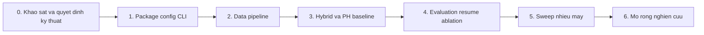

# Kế hoạch triển khai framework nghiên cứu Structural Defect Detection

Phiên bản tài liệu: 1.0 — ngày 2026-10-22. Trạng thái: đã triển khai phần mềm và kiểm thử trên crop CUBIT thật và GPU dry-run; còn audit và experiment CUBIT-InSeg thực. Checkbox đánh dấu phần công việc đã thực hiện, không thay thế điều kiện nghiệm thu từng giai đoạn. Bằng chứng và quyết định: [IMPLEMENTATION_STATUS.md](../IMPLEMENTATION_STATUS.md).

Đặc tả yêu cầu và tiêu chí nghiệm thu: [spec.md](spec.md). Nguồn quyết định kiến trúc: [RESEARCH_FRAMEWORK_ARCHITECTURE.md](RESEARCH_FRAMEWORK_ARCHITECTURE.md).

## 1. Mục tiêu bàn giao và thứ tự phụ thuộc

Bàn giao v1 là một luồng nghiên cứu chạy được với ít nhất một dataset semantic segmentation thực đã kiểm tra: validate → manifest/split → train Hybrid CNN–Swin có PH → validation/chọn checkpoint → test → prediction/report. V1 có ablation tắt PH, epoch-boundary resume và YAML sweep phân shard trên nhiều máy.

Giai đoạn 0 chuẩn bị và theo dõi quyết định kỹ thuật. Giai đoạn 1–5 tạo thành v1. Giai đoạn 6 là mở rộng sau khi baseline và protocol đã được kiểm chứng.

Giai đoạn 0 bắt đầu bằng kiểm tra dữ liệu/môi trường và feasibility probes nhỏ. Quyết định cần full model hoặc data pipeline được hoàn tất ở giai đoạn sở hữu tương ứng, tránh yêu cầu model hoàn chỉnh trước khi có package. Không bắt đầu full experiment khi DEC-01 đến DEC-06 còn thiếu bằng chứng liên quan.

Mỗi giai đoạn lưu bằng chứng kiểm tra cùng config/environment áp dụng. Các test bên dưới được truy vết sang bộ kiểm thử và báo cáo implementation; hạng mục dữ liệu thực còn thiếu được giữ mở.

## 2. Giai đoạn 0 — Xác minh kỹ thuật

**Mục tiêu:** biến các chi tiết chưa khóa trong kiến trúc thành quyết định có thể kiểm tra.

**Dependencies:** tài liệu kiến trúc, spec, quyền truy cập release dữ liệu và môi trường mục tiêu khi thực hiện kiểm tra. Thiếu dữ liệu hoặc GPU phải ghi rõ kiểm tra đang thiếu; không thay bằng kết quả giả định.

**Yêu cầu liên quan:** FR-DATA-02, FR-MODEL-04, FR-LOSS-03, FR-LOSS-04, FR-LOSS-05, FR-RUN-02. Theo dõi DEC-01, DEC-02, DEC-03, DEC-04, DEC-05, DEC-06; DEC-07 dành cho mở rộng.

- [x] Lập decision register cho các mã DEC: trạng thái, lựa chọn/candidate, bằng chứng, giới hạn, giai đoạn phải khóa và lý do lựa chọn.
- [ ] Kiểm release ứng viên từ [datasets.csv](research/uav-structural-defects-2026-10-20/datasets.csv): ảnh/mask thực, annotation coverage, điều kiện sử dụng, official split, nguồn crop và duplicate.
- [x] Kiểm OS/GPU/driver/môi trường trên từng máy có sẵn; chọn phiên bản Python/PyTorch và dependencies sau compatibility check. Ghi profile chưa được kiểm tra riêng.
- [x] Kiểm API/feature outputs của CNN/Swin candidates, đường tái sử dụng pretrained weights và chính sách projection/stride.
- [x] Thực hiện probe PH nhỏ để kiểm persistence/pairing, đường gradient và xử lý topology có annotation; loại backend chỉ tạo scalar detached.
- [x] Xác định các phép đo sẽ dùng để khóa resolution, micro-batch, PH window/frequency và giới hạn bộ nhớ. Hyperparameter thử nghiệm được ghi là candidate, chưa phải khuyến nghị đã kiểm chứng.

**Đầu ra:** decision register, audit dữ liệu ban đầu, compatibility/probe reports và danh sách cấu hình cần xác minh tiếp.

**Điều kiện hoàn thành:** các chi tiết đang mở có phương pháp kiểm tra và thời điểm khóa; rủi ro về annotation/PH/VRAM được ghi cụ thể. Có candidate khả thi để bắt đầu package và adapter; quyết định model/runtime cuối cùng được xác nhận ở giai đoạn 3.

## 3. Giai đoạn 1 — Package, config, CLI và run metadata

**Mục tiêu:** xây nền tảng để các thành phần nghiên cứu có thể thay thế và được cấu hình nhất quán.

**Dependencies:** thông tin môi trường ban đầu từ giai đoạn 0. Chưa cần full dataset hoặc model hoàn chỉnh để kiểm config/CLI.

**Yêu cầu liên quan:** FR-ARCH-01, FR-ARCH-02, FR-ARCH-03, FR-CONFIG-01, FR-CONFIG-02, FR-CONFIG-03, FR-CLI-01, FR-RUN-01.

- [x] Tạo src-layout package, metadata cài đặt và dependency declarations theo môi trường đã kiểm; entry point `sdd`.
- [ ] Thiết lập các module theo spec và các hợp đồng sample/batch, feature pyramid, loss output, run result. Dùng composition và registry tường minh; tránh inheritance không cần thiết.
- [x] Triển khai typed config cho data/model/loss/training/evaluation/runtime/output, validation và resolution của base/experiment/machine/CLI.
- [x] Giới hạn machine override; kiểm field lạ, kiểu sai, settings không tương thích và đường dẫn resolve theo dataset root.
- [x] Tạo run directory/ID, resolved config/hash và metadata tối thiểu; hoàn thiện artifact writers ở các giai đoạn sau.
- [x] Xây CLI dispatcher/help và handlers gọi package. Chỉ công bố command hoạt động khi subsystem tương ứng có implementation; tránh stub trả thành công giả.
- [x] Chuẩn bị cấu trúc cấu hình base/experiments/machines/sweeps; chưa gắn nhãn cấu hình hardware là đã hỗ trợ khi chưa đo.

**Đầu ra:** package cài/import được, config loader, CLI nền tảng, data/model/loss contracts và run metadata writer.

**Kiểm chứng:** config hợp lệ, unknown field, override bị cấm, precedence, resolve paths, serialize/hash ổn định cho cùng resolved content; kiểm import và CLI help.

**Điều kiện hoàn thành:** AC-01 và AC-02 đạt cho các phần đã triển khai; downstream modules nhận typed settings, không tự đọc YAML. Việc nghiệm thu đủ toàn bộ CLI được hoàn tất ở giai đoạn 5.

## 4. Giai đoạn 2 — Adapter, manifest, split và preprocessing

**Mục tiêu:** có một nguồn semantic segmentation thực đi qua pipeline chuẩn, bảo toàn nhãn và chống leakage.

**Dependencies:** giai đoạn 1; DEC-01 được khóa trước khi chấp nhận adapter.

**Yêu cầu liên quan:** FR-DATA-01, FR-DATA-02, FR-DATA-03, FR-DATA-04, FR-DATA-05, FR-DATA-06, FR-DATA-07, FR-CLI-01.

- [ ] Triển khai adapter đầu tiên theo release đã audit; hỗ trợ chuẩn hóa semantic masks và instance → semantic nếu nguồn yêu cầu.
- [x] Tạo manifest có identity, source/release, relative paths, dimensions, annotation coverage và metadata thực có; validate file/mask alignment và class mapping.
- [x] Chuẩn hóa binary target cùng valid mask; kiểm missing labels, padding và overlap policy. Reject nguồn chỉ có boxes/image labels khi được cấu hình như pixel supervision.
- [x] Tạo/kiểm split ảnh gốc theo group trước crop; bảo toàn official protocol, ghi internal protocol riêng khi cần; kiểm duplicate và lưu hashes.
- [x] Triển khai transforms đồng bộ và transform record cho patch/resize/tiling; mask interpolation không tạo class giả. Tạo fixture ghép patch/khôi phục tọa độ.
- [ ] Triển khai dataset/loaders/sampler theo schema chung, nhận sampling weights. Dùng fixture nhiều nguồn để kiểm interface; adapter thực bổ sung thuộc giai đoạn 6.
- [x] Hoàn thiện `sdd data validate` và `sdd data split`, xuất báo cáo validation/split có metadata coverage và giới hạn kiểm leakage.

**Đầu ra:** adapter đã kiểm, manifest/split cố định, preprocessing/loaders và data validation report.

**Kiểm chứng:** fixture nhãn rỗng, ignore, instance overlap, thiếu metadata; đồng bộ transform; train/validation/test không giao group theo protocol; duplicates được phát hiện; ảnh crop không vượt split ảnh gốc.

**Điều kiện hoàn thành:** AC-03 và phần dữ liệu của AC-04 đạt; có batch thực đúng shape và split hash cố định cho baseline. Chất lượng/mức đầy đủ metadata được ghi, không tuyên bố đã loại mọi leakage khi dữ liệu không cho phép xác minh.

## 5. Giai đoạn 3 — Hybrid nối tiếp và PH baseline

**Mục tiêu:** baseline `hybrid_ph` hoạt động ngay trong luồng training đầu tiên.

**Dependencies:** giai đoạn 1–2; đóng DEC-02, DEC-03, DEC-04 và cấu hình thử nghiệm ban đầu của DEC-05 bằng bằng chứng giai đoạn này.

**Yêu cầu liên quan:** FR-MODEL-01, FR-MODEL-02, FR-MODEL-03, FR-MODEL-04, FR-LOSS-01, FR-LOSS-02, FR-LOSS-03, FR-LOSS-04, FR-LOSS-05, FR-EXP-01, FR-TRAIN-01, FR-TRAIN-03, FR-RUN-01, FR-RUN-02.

- [x] Xây CNNEncoder tạo feature pyramid, FeatureProjection, SwinFeatureProcessor và decoder nhận multiscale CNN skips; model trả full-resolution logits.
- [x] Validate channels/strides/layout/head divisibility; xử lý window padding và skip alignment; khai báo patch merging/downsampling tường minh.
- [x] Nạp pretrained theo policy đã kiểm, ghi layer được nạp/thay/reinitialize; không giả định input CNN features tương đương ảnh RGB của Swin pretrained.
- [x] Triển khai Dice/Focal/PH và CompositeLoss; PH training-only, H0 mặc định, H1 tắt. Đối chiếu topology annotation, không cố định một component cho mọi sample.
- [x] Tích hợp TopologyBackend có gradient tới model; khóa policy ignore/crop boundary/empty và all-ignore samples bằng tests trên annotation thật và bản sao dùng kiểm lỗi.
- [x] Xây Trainer với optimizer/scheduler, validation Dice tối thiểu, AMP/accumulation, metrics logs và checkpoint save; khôi phục đầy đủ state được hoàn thiện ở giai đoạn 4.
- [ ] Hoàn thiện `sdd train`, cấu hình `hybrid_ph` và một run ngắn từ batch thực đến validation/checkpoint. Cấu hình thử ngắn phải được phân biệt với protocol nghiên cứu dài.
- [x] Đo peak memory, step time và overhead PH theo hardware thực; thử cấu hình 8 GB trước khi xác nhận hỗ trợ profile đó. Ghi actual precision/batch/accumulation/normalization.
- [x] Ghi failure có chẩn đoán cho OOM/non-finite; không tự đổi resolution/PH dưới cùng run ID.

**Đầu ra:** Hybrid + PH chạy forward/backward và short training, checkpoint, logs, pretrained report, PH correctness report và memory/runtime report.

**Kiểm chứng:** kích thước chia hết/không chia hết window; topology từ annotation thật và prediction tương ứng; finite gradients; kiểm PH làm thay đổi model update khi các yếu tố còn lại được giữ cố định; overfit tập rất nhỏ; inject failure để kiểm chẩn đoán.

**Điều kiện hoàn thành:** AC-05, AC-06 và phần training của AC-07 đạt trên profile đã kiểm chứng. Các thành phần PH có thể kiểm độc lập, nhưng baseline tích hợp bàn giao phải bật PH. Full train→test→prediction smoke được hoàn tất ở giai đoạn 4.

## 6. Giai đoạn 4 — Evaluation, inference, resume và đối chứng

**Mục tiêu:** đánh giá có protocol, chạy lại được từ checkpoint và đo tác động PH bằng ablation cùng kiến trúc.

**Dependencies:** baseline giai đoạn 3; khóa evaluation/threshold/empty-mask policy thuộc DEC-06 trước test.

**Yêu cầu liên quan:** FR-EXP-01, FR-EXP-02, FR-TRAIN-02, FR-EVAL-01, FR-EVAL-02, FR-INFER-01, FR-RUN-01, FR-RUN-02, FR-RUN-03, FR-CLI-01.

- [x] Hoàn thiện Evaluator/metrics cho segmentation và topology, ignore mask, empty-mask convention, dataset/domain/seed breakdown và sample counts.
- [x] Lưu evaluation policy; chọn checkpoint theo validation crack Dice, khóa threshold/objective trước test. Tách external test khỏi mọi quyết định tuning.
- [x] Xây Predictor/PredictionWriter, full-image/tiling reconstruction và mask/overlay/region outputs về tọa độ gốc; hoàn thiện `sdd evaluate` và `sdd predict`.
- [x] Hoàn thiện checkpoint model/optimizer/scheduler/scaler/RNG/epoch-step/sampler state; validate compatibility và resume tại epoch boundary.
- [x] So sánh uninterrupted và resumed run trên cùng môi trường với tolerance đã nêu trong test; không công bố mid-epoch resume khi thiếu data pipeline state.
- [x] Thêm `hybrid_no_ph` với cùng model và PH weight 0; giữ split/preprocessing/seeds/optimizer/steps/effective batch để đối chứng. Bypass chi phí tính PH khi tắt, lưu trạng thái PH trong artifacts.
- [x] Chạy short end-to-end train→validation→checkpoint→test→prediction cho baseline và short ablation; giữ riêng wall time/PH overhead và metrics từng dataset/domain.

**Đầu ra:** evaluator/predictor, đầy đủ run artifacts, resume verification, PH/no-PH configs và báo cáo chạy ngắn.

**Kiểm chứng:** perfect mask, empty ground truth/prediction, crack đứt, ignore regions/all-ignore handling; output reconstruction; resume state và checkpoint mismatch; kiểm provenance của checkpoint/threshold đã chọn.

**Điều kiện hoàn thành:** hoàn tất AC-04 và AC-07; AC-08, AC-09 đạt. Run ngắn chứng minh luồng phần mềm, chưa đủ kết luận PH cải thiện chất lượng trên dataset thực.

## 7. Giai đoạn 5 — YAML sweep và nhiều máy

**Mục tiêu:** tái lập danh sách experiment, phân việc độc lập và tổng hợp kết quả đúng identity/protocol.

**Dependencies:** giai đoạn 4; DEC-01 đến DEC-06 có cấu hình/protocol đủ kiểm chứng trước sweep nghiên cứu dài.

**Yêu cầu liên quan:** FR-SWEEP-01, FR-SWEEP-02, FR-SWEEP-03, FR-SWEEP-04, FR-SWEEP-05, FR-CONFIG-02, FR-CONFIG-03, FR-EXP-02, FR-RUN-01, FR-RUN-02, FR-RUN-03, FR-CLI-01.

- [x] Triển khai SweepPlanner cho grid/random, seeds, conditional groups và bounded random search; materialize plan cố định trước chạy.
- [x] Gán trial/run IDs xác định; tránh trial trùng chỉ khác các PH settings bị vô hiệu khi weight 0. Lưu cả planning seed và training seed.
- [x] Triển khai SweepRunner với pending/running/completed/failed, skip completed và retry/resume tường minh; giới hạn một run đồng thời trên mỗi device.
- [x] Hỗ trợ shard index/count hoặc danh sách run IDs, xác minh shard assignment không chồng nhau; không thêm distributed training/scheduler tập trung.
- [x] Tạo machine config theo data/output roots, device/workers và runtime được phép. Giữ protocol khi đổi micro-batch/accumulation, ghi BatchNorm/stochastic/hardware differences.
- [x] Triển khai collect từ outputs tách biệt: xác minh run ID, plan/config/manifest/split identity, phát hiện duplicate/incompatibility, missing/failed runs và giữ provenance máy.
- [x] Phân biệt full resolved config hash với experiment compatibility: đường dẫn máy khác nhau vẫn được phép nếu nội dung dữ liệu/protocol tương ứng được xác minh; runtime thực luôn được lưu.
- [x] Hoàn thiện `sdd sweep plan`, `sdd sweep run`, `sdd sweep collect`; xuất bảng từng run/dataset/domain/seed trước thống kê tổng hợp.
- [x] Chạy smoke sweep nhỏ có ít nhất hai shards và roots tách biệt, bao gồm completed/failed/retry/resume. Test logic sharding có thể dùng môi trường cục bộ; chỉ đánh dấu máy/GPU đã kiểm chứng sau lần chạy thực trên máy đó.

**Đầu ra:** YAML sweep hoạt động, immutable plan, execution state, machine profiles đã kiểm/chưa kiểm và collected reports.

**Kiểm chứng:** deterministic planning, random budget, PH-off deduplication, shard disjointness/completeness, completed skip, failed exclusion, duplicate/hash mismatch và thu kết quả từ roots khác nhau.

**Điều kiện hoàn thành:** AC-10, AC-11 đạt; AC-01 đến AC-09 vẫn đạt trên cấu hình baseline. V1 được chấp nhận khi có bằng chứng cho AC-01 đến AC-11; hardware chưa chạy được ghi rõ, không suy diễn từ smoke test mô phỏng thư mục.

## 8. Giai đoạn 6 — Mở rộng nghiên cứu và tối ưu

**Mục tiêu:** bổ sung dữ liệu và phương án compute sau khi baseline/protocol v1 ổn định.

**Dependencies:** giai đoạn 5; DEC-07 được khóa theo từng nhánh mở rộng, DEC-03/DEC-05 được xác minh lại khi thay architecture/runtime.

**Yêu cầu liên quan:** FR-DATA-07, FR-EXT-01, FR-EXT-02, FR-EXT-03, FR-EXP-02, FR-RUN-03.

- [ ] Bổ sung adapters sau audit release/annotation/conditions/duplicates; chạy experiment một nguồn và phối hợp nguồn với sampling weights tường minh.
- [ ] Nếu triển khai multiclass, chốt coverage/overlap/missing-label policies, class-index target và softmax trước trộn nhãn; không chuyển ngầm thành multilabel.
- [x] Triển khai `hybrid_efficient_cnn_ph`, ưu tiên giữ feature/stride contract; ghi biến thể khi thay contract và đo CNN/Swin/decoder/toàn pipeline.
- [x] Bổ sung `cnn_only` với replacement/decoder adapter/PH status rõ ràng để tách tác động model và loss.
- [ ] Triển khai Profiler/DeviceMonitor và `sdd profile`; lưu phương pháp đo, precision, resolution, batch và device.
- [ ] Chọn export backend theo target và kiểm output tương thích trước benchmark. Chỉ đóng gói container/edge profile khi có môi trường mục tiêu; resource-limit desktop phải ghi đúng hardware.
- [x] Báo power/energy chỉ khi có telemetry phù hợp; nếu không, ghi unavailable.

**Đầu ra:** adapters/experiment bổ sung, bảng accuracy/topology/compute, profiling/export reports và target-specific environment nếu được triển khai.

**Điều kiện hoàn thành:** AC-12 đạt cho từng khả năng được triển khai, regression v1 vẫn đạt. Không cần hoàn tất toàn bộ giai đoạn 6 để công nhận v1.

## 9. Ma trận kiểm chứng và tiến độ

| Nhóm nghiệm thu trong spec | Giai đoạn chịu trách nhiệm hoàn tất | Bằng chứng chính |
|---|---|---|
| AC-01, AC-02 | 1; CLI đầy đủ tại 5 | Package/config/CLI checks |
| AC-03 | 2 | Adapter fixtures và audit nguồn thực |
| AC-04 | 2 và 4 | Split/transform/reconstruction reports |
| AC-05, AC-06 | 3 | Model/PH tests, gradients, weights, memory/runtime |
| AC-07 | 3 và 4 | Tiny-set overfit, end-to-end run artifacts và failure handling |
| AC-08, AC-09 | 4 | Resume comparison, metrics edge cases, matched ablation protocol |
| AC-10, AC-11 | 5 | Sweep/shard/collect tests và smoke outputs |
| AC-12 | 6 | Audit bổ sung, controlled comparisons, profiling/export validation |

Trình tự kiểm tra: unit/contract checks → model/PH checks trên dữ liệu thật qua --dry-run → tiny real-data run → resume/ablation → sweep smoke → experiment dài. Chạy lại các kiểm tra bị ảnh hưởng khi thay model, loss, data hoặc protocol; không dùng thời lượng full training để thay cho việc kiểm lỗi hợp đồng.

Theo dõi hoàn thành bằng checkbox cùng đường dẫn bằng chứng, config hashes và environment. Không đánh dấu một giai đoạn đạt chỉ vì đã tạo tên file/class hoặc command stub. Run thất bại, giới hạn hardware và các quyết định còn mở phải xuất hiện trong báo cáo bàn giao.

## 10. Giả định và nguyên tắc thay đổi

- Phạm vi Deep Learning được giữ rộng; cấu hình tham chiếu v1 vẫn là Hybrid CNN → Swin có CNN skips và PH. Tối ưu CNN/multiclass/edge là các bước mở rộng được kiểm riêng.
- Baseline đầu tiên dùng một dataset đã audit; nhiều dataset đi qua cùng interface, nhưng không tải/trộn toàn bộ danh mục một cách mặc định.
- Thông số backbone, pretrained, PH backend, resolution và dependency versions được khóa qua DEC tương ứng, không được suy ra từ ví dụ YAML hoặc dung lượng VRAM danh nghĩa.
- V1 dùng một GPU mỗi run; nhiều máy chạy các run độc lập và gom kết quả, không cần shared filesystem hoặc cùng OS.
- Mỗi thay đổi làm đổi protocol/model/data phải được ghi version/config identity phù hợp; resume không trở thành cách âm thầm sửa experiment đang chạy.
- Code và kiểm chứng phần mềm đã có tại repository. Kết quả dry-run và các crop kiểm phần mềm không phải benchmark CUBIT; xem implementation status trước khi khóa protocol nghiên cứu.
