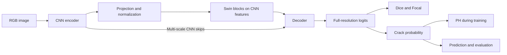

# Đặc tả framework nghiên cứu Structural Defect Detection

Phiên bản tài liệu: 1.0 — ngày 2026-10-22. Trạng thái: đặc tả yêu cầu v1. Tiến độ implementation và bằng chứng kiểm chứng được theo dõi tại [IMPLEMENTATION_STATUS.md](../IMPLEMENTATION_STATUS.md); chưa nghiệm thu trên dataset thực.

Nguồn thiết kế: [RESEARCH_FRAMEWORK_ARCHITECTURE.md](RESEARCH_FRAMEWORK_ARCHITECTURE.md). Thứ tự công việc và điều kiện hoàn thành nằm trong [implementation_plan.md](implementation_plan.md). Tài liệu này cụ thể hóa các quyết định kiến trúc đã thống nhất; thay đổi quyết định phải được ghi nhận đồng bộ trong cả ba tài liệu.

## 1. Mục tiêu và phạm vi

Xây dựng Python package phục vụ nghiên cứu Deep Learning cho semantic segmentation khuyết tật trên công trình xây dựng và hạ tầng công cộng, hướng tới ảnh UAV. Framework phải hỗ trợ thay thành phần model, loss và dataset để thực hiện experiment có thể kiểm tra và so sánh. Không mặc định mọi dataset đều được thu bằng UAV; nguồn ảnh và domain phải được ghi đúng theo dữ liệu có sẵn.

V1 tập trung binary semantic segmentation: crack/background, có ignore pixels. Baseline chính là Hybrid CNN–Swin Transformer nối tiếp, có CNN skip connections và persistent-homology loss (PH). Baseline là cấu hình tham chiếu nghiên cứu; hiệu quả và tính mới phải được đánh giá riêng bằng bằng chứng thực nghiệm.

Luồng v1: kiểm tra dữ liệu → manifest chuẩn → split cố định → train `hybrid_ph` → validation/chọn checkpoint → test → xuất prediction/báo cáo. V1 bao gồm đối chứng `hybrid_no_ph`, resume, YAML sweep và phân công các run độc lập trên nhiều máy.

| Phạm vi | Nội dung |
|---|---|
| Bắt buộc v1 | Một adapter cho dataset đã kiểm tra; hợp đồng cho nhiều dataset; model/loss/train/evaluate/predict; CLI/YAML; sweep grid/random; artifacts và truy vết experiment |
| Giai đoạn mở rộng | Thêm adapter và experiment phối hợp dataset; tối ưu CNN; CNN-only; multiclass; profiling/export chuyên biệt và thiết bị edge |
| Ngoài v1 | Web UI, drone control, live streaming, distributed training nhiều máy cho một run, scheduler tập trung, cam kết real-time trên edge |

Phần mềm hướng tới GPU RTX 3070 Ti 8 GB, RTX 3060 12 GB và RTX 4090 24 GB, một GPU mỗi run. Resolution và cấu hình vừa bộ nhớ phải được đo thực tế. Thiết bị edge chưa được chọn.

## 2. Cách đọc yêu cầu

Mã `FR-*` định danh yêu cầu chức năng/hợp đồng. Các yêu cầu mặc định thuộc v1, trừ nhóm `FR-EXT-*` ghi rõ là mở rộng. Mã `AC-*` định danh tiêu chí nghiệm thu; mã `DEC-*` định danh quyết định kỹ thuật cần có bằng chứng trước khi khóa. Hoàn thành tài liệu không đồng nghĩa các tiêu chí nghiệm thu phần mềm đã đạt.

## 3. Kiến trúc package và interface

| Mã | Yêu cầu |
|---|---|
| `FR-ARCH-01` | Package `structural_defect_detection` dùng src layout tại `src/structural_defect_detection/`, Python + PyTorch; phiên bản môi trường được khóa sau kiểm tra compatibility. |
| `FR-ARCH-02` | Tổ chức OOP theo composition. Model và loss học sâu dùng `torch.nn.Module`; function được dùng cho xử lý không có trạng thái. ABC/protocol chỉ đặt tại ranh giới cần nhiều implementation; registry tên → factory tường minh. |
| `FR-ARCH-03` | Luồng phụ thuộc: CLI → ExperimentRunner → data/model/loss/Trainer. Model không đọc YAML/dataset/logger; loss không quản lý optimizer hoặc training loop; CLI không chứa logic nghiên cứu. Evaluator/Predictor dùng lại cùng hợp đồng model và preprocessing. |

| Module | Thành phần dự kiến | Trách nhiệm |
|---|---|---|
| `config` | Config dataclass, `ConfigLoader` | Resolve và validate cấu hình; cung cấp typed settings bất biến cho run |
| `data` | `DatasetAdapter`, `ManifestBuilder`, `SplitBuilder`, `SegmentationDataset`, `DataModule` | Chuyển nguồn về schema chung, quản lý split/transforms/loaders/sampling |
| `models` | `SegmentationModel`, `CNNEncoder`, `FeatureProjection`, `SwinFeatureProcessor`, `SegmentationDecoder`, `HybridCNNSwin` | Xử lý tensor và trả logits |
| `losses` | `CompositeLoss`, `PersistentHomologyLoss`, `TopologyBackend` | Tính loss khả vi và các thành phần có tên |
| `engine` | `Trainer`, `CheckpointManager` | Training/validation, optimizer/scheduler, AMP, accumulation, checkpoint/resume |
| `evaluation` | `Evaluator`, `SegmentationMetrics`, `TopologyMetrics` | Đánh giá theo dataset/domain, topology evaluation độc lập với training loss |
| `inference` | `Predictor`, `PredictionWriter` | Predict, khôi phục tọa độ gốc, xuất masks/overlays/region records |
| `experiments` | `ExperimentRunner`, `SweepPlanner`, `SweepRunner`, `ResultAggregator` | Quản lý run, sweep cố định, shard, trạng thái và tổng hợp |
| `profiling` | `Profiler`, `DeviceMonitor`, `ModelExporter` | Ranh giới cho profiling/export mở rộng; v1 vẫn phải ghi tài nguyên và thời gian training |
| `cli` | Command handlers cho `sdd` | Nhận tham số và gọi package |

Hợp đồng trao đổi tối thiểu:

| Đối tượng | Input/output bắt buộc |
|---|---|
| Sample/batch | Image tensor, target, valid-pixel mask, sample metadata và transform record |
| Model | Nhận RGB image tensor `[B,3,H,W]`; trả raw logits `[B,1,H,W]` ở resolution đầu vào; activation/threshold thuộc loss hoặc inference/evaluation |
| Feature pyramid | Các feature level có tên, tensor, channel và stride; metadata đủ để kiểm tra projection và skip alignment |
| Composite loss | Nhận logits, target và valid mask; trả scalar tổng loss để backward cùng các thành phần có tên để logging |
| Evaluation result | Metrics, split/dataset/domain, số mẫu hợp lệ và policy đánh giá; không chỉ một điểm tổng hợp |
| Run result | Run ID, trạng thái, config/manifest/split hashes, seed, đường dẫn artifacts và thông tin lỗi nếu có |

## 4. Dữ liệu và annotation

| Mã | Yêu cầu |
|---|---|
| `FR-DATA-01` | Adapter đưa từng định dạng nguồn về manifest chuẩn. Manifest có `sample_id`, `dataset_id`, image/mask paths tương đối với dataset root, release/version, split, kích thước ảnh và annotation coverage. Identity của sample phải duy nhất trong phạm vi dataset. |
| `FR-DATA-02` | Khi có, lưu `source_image_id`, `structure_id`, `capture_session_id`, platform, material và quan hệ crop/ảnh gốc. Dữ liệu không có được ghi unknown; không suy diễn ảnh từ UAV hoặc nhóm công trình. Kiểm tra release, điều kiện sử dụng và annotation thực tế trước khi chọn adapter. |
| `FR-DATA-03` | V1 dùng target crack/background và valid mask chuẩn hóa tương ứng `[B,1,H,W]`; valid mask xác định pixel được tính loss/metrics. Chỉ coi vùng không có crack là negative khi annotation protocol cho phép; nhãn thiếu/không rõ là ignore. Boxes/image labels không trực tiếp làm pixel supervision. |
| `FR-DATA-04` | Instance masks cùng lớp được hợp thành semantic mask. Overlap giữa lớp phải được phát hiện và có policy được ghi nhận; thứ tự đọc annotation không được quyết định lớp thắng. |
| `FR-DATA-05` | Split ảnh gốc trước crop/augmentation; ưu tiên group công trình/phiên thu/ảnh gốc theo metadata có thật. Khóa manifest/split trước sweep; kiểm duplicate/source leakage. Giữ official benchmark split; nếu cần protocol internal thì lưu tách và báo cáo giới hạn metadata. |
| `FR-DATA-06` | Transform hình học đồng bộ image/target/valid mask; mask dùng nội suy phù hợp nhãn rời rạc. Padding được ignore. Training patch, full-image resize và tiling là chế độ tường minh; lưu transform record đủ để ghép patch và khôi phục tọa độ gốc khi đánh giá. |
| `FR-DATA-07` | Data pipeline nhận được nhiều nguồn theo schema chung và sampling weights được cấu hình/ghi lại. Chỉ trộn các nguồn có supervision tương thích; một adapter đã kiểm chứng là mức bàn giao tối thiểu v1. |

Danh mục ứng viên: [datasets.csv](research/uav-structural-defects-2026-10-20/datasets.csv). CUBIT-InSeg/CUBIT-Seg là ứng viên building; S2DS là ứng viên hạ tầng; DeepCrack/CRACK500/UAV-CrackX bổ sung crack/domain. Danh mục này không đồng nghĩa đã chọn release hoặc đã tải và kiểm dữ liệu.

## 5. Model và experiment

| Mã | Yêu cầu |
|---|---|
| `FR-MODEL-01` | Baseline là CNN → FeatureProjection → SwinFeatureProcessor → decoder, có CNN skip features nhiều mức. Swin xử lý feature map từ CNN; không dùng một nhánh Swin RGB độc lập. |
| `FR-MODEL-02` | CNN tạo feature pyramid; một mức được chọn vào Swin, các mức có resolution cao hơn đi vào decoder. Projection ánh xạ channel → embedding dimension, normalization và layout; không global/classification pooling trước Swin. |
| `FR-MODEL-03` | Config khai báo CNN backbone, feature level, embedding dimension, blocks/stages, heads, window size, patch merging, skip levels và decoder. Kiểm tra channel/stride/layout/head divisibility. Downsampling thêm phải tường minh; xử lý window padding/unpadding và output alignment đúng. |
| `FR-MODEL-04` | Ghi rõ pretrained source và layers được nạp/thay/khởi tạo mới. Feature stride/resolution là biến experiment vì ảnh hưởng crack mảnh; PH không được xem là bảo đảm khôi phục chi tiết đã mất. |
| `FR-EXP-01` | `hybrid_ph` là baseline chính ngay từ phiên bản training đầu tiên. `hybrid_no_ph` dùng cùng model và PH weight bằng 0; không phải một kiến trúc khác. |
| `FR-EXP-02` | So sánh PH/no-PH giữ cùng split, preprocessing, seed protocol, optimizer, số training steps và effective batch; ghi actual micro-batch, accumulation, normalization và hardware. Báo cáo wall time/PH overhead riêng; không coi cùng thời gian chạy là đủ để matched-budget. |

Họ experiment dự kiến:

| Experiment | Vai trò | Thời điểm |
|---|---|---|
| `hybrid_ph` | Hybrid nối tiếp + Dice/Focal/PH | Baseline v1 |
| `hybrid_no_ph` | Cùng Hybrid, tắt PH | Đối chứng bắt buộc v1 |
| `hybrid_efficient_cnn_ph` | Giảm chi phí CNN, đo compute toàn pipeline | Sau v1 |
| `cnn_only` | Đối chứng không có Swin; khai báo phần thay thế, decoder adapter và trạng thái PH | Sau baseline đầu tiên, thuộc mở rộng |

## 6. Loss và topology

| Mã | Yêu cầu |
|---|---|
| `FR-LOSS-01` | Composite loss kết hợp Dice + Focal + PH, trả tổng và thành phần có tên. PH dùng crack probability map trong training và đối chiếu annotation cùng miền không gian; inference không cần tính PH. |
| `FR-LOSS-02` | H0 mặc định; H1 tắt và chỉ bật khi annotation/protocol có cơ sở. Target topology theo annotation từng sample/window; không ép mọi ảnh thành một connected component. |
| `FR-LOSS-03` | `TopologyBackend` phải có đường gradient hợp lệ tới model. Pairing tính ngoài graph có thể chấp nhận nếu loss lấy giá trị khả vi từ tensor gốc. Scalar hoàn toàn detached và thresholded component counts/clDice không được thay thế PH training loss. |
| `FR-LOSS-04` | Window/crop, resolution, persistence filtering, weight schedule và tần suất PH được ghi vào config. Ignore pixels và biên crop có policy riêng đã kiểm tra; không mặc định tô ignore thành background. Không ngầm thay resolution hoặc PH để tránh OOM. |
| `FR-LOSS-05` | Trước full training, kiểm topology trên annotation thật, empty masks, vùng không có valid pixels, finite backward và ảnh hưởng PH lên model update. Ca không đủ supervision phải được xử lý tường minh, không chia cho 0 hoặc tạo target topology giả. Đo chi phí PH trên cấu hình GPU 8 GB trước khi tuyên bố hỗ trợ cấu hình đó. |

## 7. Cấu hình và CLI

| Mã | Yêu cầu |
|---|---|
| `FR-CONFIG-01` | YAML có các nhóm `data`, `model`, `loss`, `training`, `evaluation`, `runtime`, `output`. Load thành typed settings; field lạ, kiểu sai và cấu hình không tương thích phải lỗi sớm. |
| `FR-CONFIG-02` | Precedence: base → experiment → machine override trong allowlist → CLI. Machine YAML chứa data/output roots, device và worker settings; runtime chứa micro-batch/AMP. Không để machine override âm thầm đổi model, loss, resolution hoặc split. |
| `FR-CONFIG-03` | Resolve config một lần cho run, lưu resolved YAML và hash. Dataset paths trong manifest resolve theo root máy cục bộ. Giá trị YAML minh họa phải được phân biệt với cấu hình experiment đã kiểm chứng. |
| `FR-CLI-01` | CLI `sdd` gọi package qua handlers mỏng; các lệnh làm việc nhận config path. Train hỗ trợ checkpoint resume; evaluate yêu cầu manifest/split rõ ràng. CLI chưa có implementation không được mô tả là đã chạy được. |

| Lệnh dự kiến | Kết quả mong đợi | Phạm vi |
|---|---|---|
| `sdd data validate` | Validate nguồn/manifest/annotation, báo lỗi và coverage | V1 |
| `sdd data split` | Tạo hoặc kiểm split cố định theo protocol | V1 |
| `sdd train` | Training, validation, logs và checkpoints; có resume | V1 |
| `sdd evaluate` | Metrics/report trên manifest và split đã chỉ định | V1 |
| `sdd predict` | Prediction và artifacts theo tọa độ ảnh gốc | V1 |
| `sdd sweep plan` | Materialize trial/seed/run IDs trước execution | V1 |
| `sdd sweep run` | Chạy plan hoặc shard được giao | V1 |
| `sdd sweep collect` | Kiểm và tổng hợp outputs từ nhiều máy | V1 |
| `sdd profile` | Đo model/pipeline theo backend phần cứng hỗ trợ | Mở rộng |

## 8. Training, evaluation và inference

| Mã | Yêu cầu |
|---|---|
| `FR-TRAIN-01` | Trainer quản lý optimizer/scheduler, training/validation, AMP và gradient accumulation. Một GPU mỗi run; effective batch, optimizer steps và normalization policy phải được ghi lại. |
| `FR-TRAIN-02` | Checkpoint chứa model, optimizer, scheduler, AMP scaler, RNG, epoch/step và sampler state cần thiết. V1 hỗ trợ resume ở ranh giới epoch; chỉ công bố mid-epoch resume khi phục hồi đủ data pipeline state. Kiểm compatibility trước resume. |
| `FR-TRAIN-03` | OOM/non-finite loss phải có chẩn đoán và trạng thái lỗi; không tự giảm resolution/đổi loss rồi tiếp tục cùng run ID. Thay cấu hình nghiên cứu tạo run mới; resume của run cũ phải giữ protocol tương thích. |
| `FR-EVAL-01` | Chọn checkpoint mặc định theo validation crack Dice; topology metrics báo cáo riêng. Threshold, aggregation policy hoặc objective đa mục tiêu phải được xác định bằng protocol validation trước khi xem test. External test không chọn hyperparameter/threshold/checkpoint. |
| `FR-EVAL-02` | Báo cáo segmentation và topology metrics theo dataset/domain và seed trước khi aggregate. Định nghĩa rõ threshold, ignore handling, empty-mask convention, aggregation và số mẫu hợp lệ; kiểm các ca perfect, empty, crack đứt và ignore. |
| `FR-INFER-01` | Predictor dùng preprocessing tương thích training/evaluation, tắt gradient, khôi phục mask về tọa độ gốc. Với tiling, ghép patch và bỏ padding đúng; PredictionWriter lưu mask/overlay/region records kèm nguồn sample và transform. Region records không ngầm là đo kích thước vật lý khi thiếu calibration. |

## 9. Sweep, nhiều máy và artifacts

| Mã | Yêu cầu |
|---|---|
| `FR-SWEEP-01` | Sweep khai báo bằng YAML, hỗ trợ grid/random, danh sách seeds và nhóm điều kiện. Random search có seed riêng và số trials hữu hạn. Không nhân bản trial chỉ khác PH settings không hoạt động khi PH bị tắt. |
| `FR-SWEEP-02` | Planner materialize plan bất biến gồm trial/seed/run IDs trước execution. Mỗi run mặc định độc chiếm một GPU; tối đa một run đồng thời trên mỗi device trong cấu hình v1. |
| `FR-SWEEP-03` | Execution ghi `pending`, `running`, `completed`, `failed`; completed được skip khi rerun plan. Failure được giữ để chẩn đoán, không chuyển thành điểm metric xấu hợp lệ; retry/resume phải tường minh. |
| `FR-SWEEP-04` | Phân việc bằng shard index/count hoặc run IDs tường minh, không chồng nhau. Máy có roots/output riêng, không giả định shared filesystem/OS. Không hứa distributed lock giữa máy không chia sẻ storage. |
| `FR-SWEEP-05` | Collect kiểm run IDs, plan/config/manifest/split identity và phát hiện kết quả trùng hoặc không tương thích trước aggregate. Khác machine paths/runtime được lưu lại; compatibility dùng nội dung experiment đã resolve, không đòi absolute paths giữa máy phải giống nhau. |
| `FR-RUN-01` | Mỗi run lưu resolved config và hash, manifest/split hashes, seed, software/hardware metadata, source revision nếu có và trạng thái dirty, metric logs, checkpoints, prediction samples và final report. Run thất bại lưu các artifacts đã tạo cùng lỗi. |
| `FR-RUN-02` | Lưu actual micro-batch/accumulation, precision, input resolution, thời gian và số steps, cùng thông tin tài nguyên đo được. Thiếu telemetry ghi unavailable; không suy diễn số đo. Không cam kết bitwise reproducibility giữa GPU/phần mềm khác nhau. |
| `FR-RUN-03` | Aggregator giữ bảng từng run/dataset/domain/seed và thống kê trên các run hợp lệ có protocol so sánh được; báo số run thành công/thất bại/thiếu. Không che domain shift bằng một điểm tổng hợp duy nhất. |

## 10. Hướng mở rộng

| Mã | Yêu cầu mở rộng |
|---|---|
| `FR-EXT-01` | Bổ sung adapter và experiment phối hợp dataset sau audit coverage/duplicate. Multiclass dùng logits `[B,K,H,W]`, class-index targets và softmax, mỗi pixel tối đa một lớp; phải có overlap/missing-label policy trước khi gộp. |
| `FR-EXT-02` | Tối ưu CNN ưu tiên giữ feature/stride contract; nếu đổi thì ghi thành biến thể kiến trúc. So sánh compute của CNN, Swin, decoder và toàn pipeline; CNN-only khai báo tường minh phần thay thế Swin và PH status. |
| `FR-EXT-03` | Profiling tách model/pipeline, lưu precision/resolution/batch/device và phương pháp đo. Export chọn theo target và kiểm output tương thích. Container là đóng gói/resource-limit trên phần cứng thật; không suy ra hiệu năng drone/Jetson. Joules/frame chỉ báo khi có power telemetry phù hợp. |

## 11. Tiêu chí nghiệm thu

Các điều kiện dưới đây là yêu cầu kiểm thử khi triển khai, chưa phải kết quả đã đạt. Không đặt ngưỡng Dice/FPS hoặc tuyên bố PH cải thiện accuracy trước thực nghiệm.

| Mã | Phạm vi yêu cầu | Bằng chứng đạt |
|---|---|---|
| `AC-01` | `FR-ARCH-01`, `FR-ARCH-02`, `FR-ARCH-03`, `FR-CLI-01` | Package cài/import được; CLI help khớp tính năng đã có; module không vượt ranh giới trách nhiệm. |
| `AC-02` | `FR-CONFIG-01`, `FR-CONFIG-02`, `FR-CONFIG-03` | Config hợp lệ resolve đúng precedence; field lạ, override không được phép và model settings không tương thích bị từ chối; resolved config/hash được lưu. |
| `AC-03` | `FR-DATA-01`, `FR-DATA-02`, `FR-DATA-03`, `FR-DATA-04`, `FR-DATA-07` | Adapter trên nguồn thực đã kiểm tra và fixture cho coverage/instance/ignore trả đúng schema; missing labels không thành negative; sampling weights được ghi nhận. |
| `AC-04` | `FR-DATA-05`, `FR-DATA-06`, `FR-INFER-01` | Split kiểm group/source overlap và duplicate theo metadata có thật; transforms/tiling/padding giữ alignment và khôi phục đúng tọa độ gốc trên fixture. |
| `AC-05` | `FR-MODEL-01`, `FR-MODEL-02`, `FR-MODEL-03`, `FR-MODEL-04` | Forward/backward cho kích thước chia hết và không chia hết window; projection/skip/output đúng shape; pretrained load report nêu rõ layers được dùng. |
| `AC-06` | `FR-LOSS-01`, `FR-LOSS-02`, `FR-LOSS-03`, `FR-LOSS-04`, `FR-LOSS-05` | Synthetic topology biết trước kiểm PH value/gradient hữu hạn; trên ca có topology error chứng minh PH đóng góp vào parameter update. Empty/ignore/crop-boundary policy có test; đo overhead/VRAM với cấu hình mục tiêu. |
| `AC-07` | `FR-EXP-01`, `FR-TRAIN-01`, `FR-TRAIN-03`, `FR-RUN-01`, `FR-RUN-02` | Overfit tập rất nhỏ và run ngắn train→validation→checkpoint→test→prediction hoàn tất với PH bật; artifacts đầy đủ. OOM/non-finite fixture tạo failure có chẩn đoán, không đổi protocol ngầm. |
| `AC-08` | `FR-TRAIN-02` | Resume ở epoch boundary trên cùng môi trường khôi phục state/step/scheduler/RNG; so với uninterrupted run bằng tolerance được xác định trong test. Checkpoint không tương thích bị từ chối. |
| `AC-09` | `FR-EXP-02`, `FR-EVAL-01`, `FR-EVAL-02`, `FR-RUN-03` | PH/no-PH dùng protocol đối chiếu được; validation chọn checkpoint, test chỉ đánh giá; metrics cho perfect/empty/crack đứt/ignore theo policy đã khóa và báo riêng từng dataset/domain/seed. |
| `AC-10` | `FR-SWEEP-01`, `FR-SWEEP-02`, `FR-SWEEP-03` | Grid/random materialize tái lập được theo seeds, không có trial vô nghĩa trùng do PH tắt; completed được skip, failed không được coi là metric hợp lệ. |
| `AC-11` | `FR-SWEEP-04`, `FR-SWEEP-05`, `FR-RUN-03` | Các shard không giao nhau và hợp lại đúng plan. Thu kết quả từ roots tách biệt, phát hiện duplicate/hash mismatch/missing runs, giữ metadata máy và metrics gốc. |
| `AC-12` | `FR-EXT-01`, `FR-EXT-02`, `FR-EXT-03` | Khi triển khai mở rộng: audit dataset/multiclass, matched comparison cho CNN variants và profiling/export correctness có báo cáo riêng. Không phải điều kiện hoàn thành v1. |

V1 hoàn thành khi AC-01 đến AC-11 đạt trên cấu hình đã khóa và có ít nhất một dataset thực đã kiểm tra. Kết quả chỉ chứng minh khả năng trên phần cứng đã đo; cấu hình 8/12/24 GB chưa được chạy phải ghi chưa kiểm chứng.

## 12. Quyết định kỹ thuật cần xác minh

Các mục sau đang mở theo tài liệu kiến trúc. Kết quả xác minh phải ghi lựa chọn, lý do, bằng chứng, ngày kiểm tra và phạm vi hardware/data áp dụng; không lấy giá trị YAML ví dụ làm kết luận thực nghiệm.

| Mã | Cần khóa | Bằng chứng trước khi khóa | Thời điểm |
|---|---|---|---|
| `DEC-01` | Dataset/release đầu tiên và mapping annotation | Mask thực, coverage, điều kiện sử dụng, duplicate, metadata/group và official split | Trước chấp nhận adapter giai đoạn 2 |
| `DEC-02` | Python/PyTorch/CUDA, dependencies và OS profiles | Cài/import và kiểm GPU/backend trên môi trường mục tiêu; lưu phiên bản thực | Trước baseline giai đoạn 3 |
| `DEC-03` | CNN/Swin variant, decoder, feature level, pretrained weights | Feature/stride/layout/skip checks, weight-loading report và bộ nhớ | Trước khóa cấu hình baseline giai đoạn 3 |
| `DEC-04` | PH backend, topology/ignore/boundary policy | Synthetic cases, gradient tới model, update effect và overhead; chính sách cho empty/all-ignore samples | Trước baseline được chấp nhận ở giai đoạn 3 |
| `DEC-05` | Input/crop/tiling resolution, micro-batch, accumulation, AMP/normalization | Memory/runtime profiling trên hardware mục tiêu, alignment và effective batch | Trước full experiment; xác minh lại khi đổi hardware/config |
| `DEC-06` | Loss weights/schedule/PH frequency/filtering và evaluation policy | Protocol có version, tests trên annotation thật và bản sao dùng kiểm lỗi và validation; threshold/empty-mask/aggregation được xác định trước test | Trước sweep nghiên cứu ở giai đoạn 5 |
| `DEC-07` | Adapter bổ sung, multiclass coverage/overlap, edge/export target | Audit dữ liệu, kiểm contract và đo target thực | Giai đoạn mở rộng |

DEC-01 đến DEC-06 không thay đổi baseline, task hoặc phạm vi đã chốt; chúng xác định cấu hình cụ thể để chạy và đánh giá đúng.
